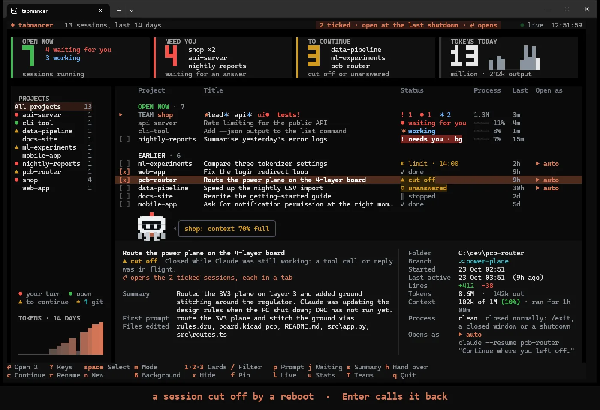
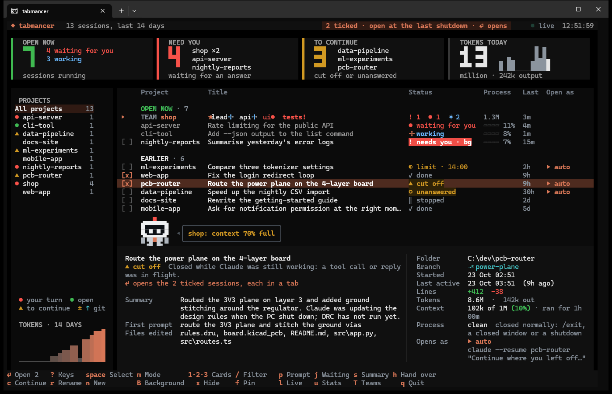
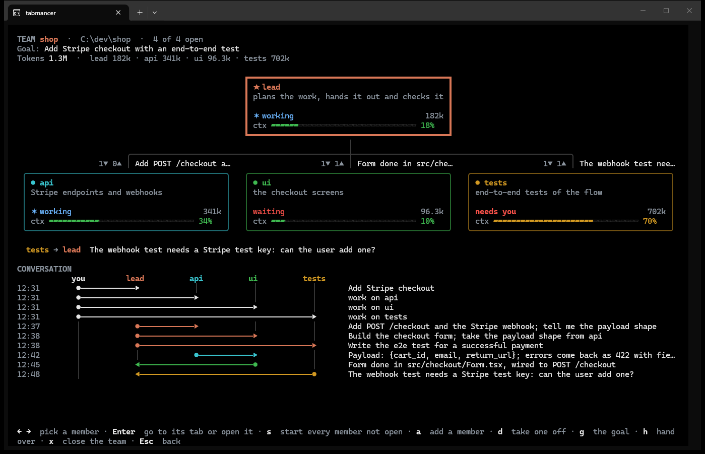
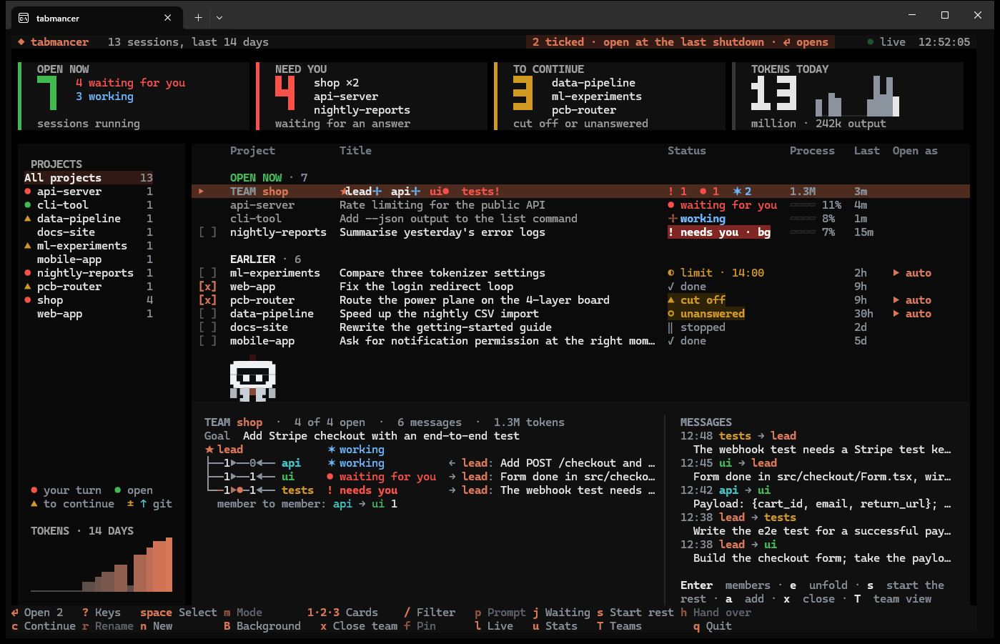
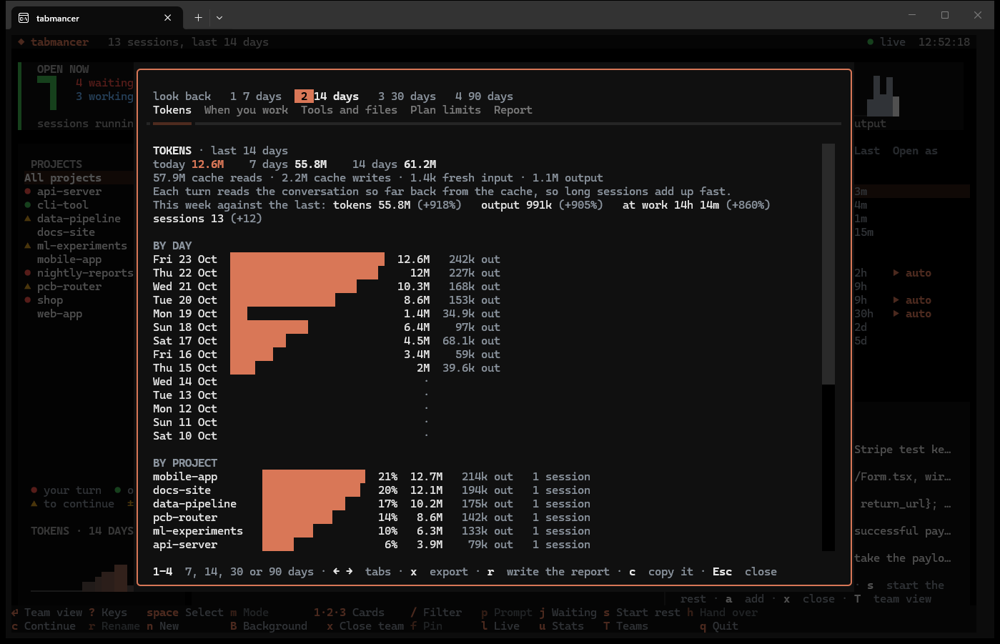
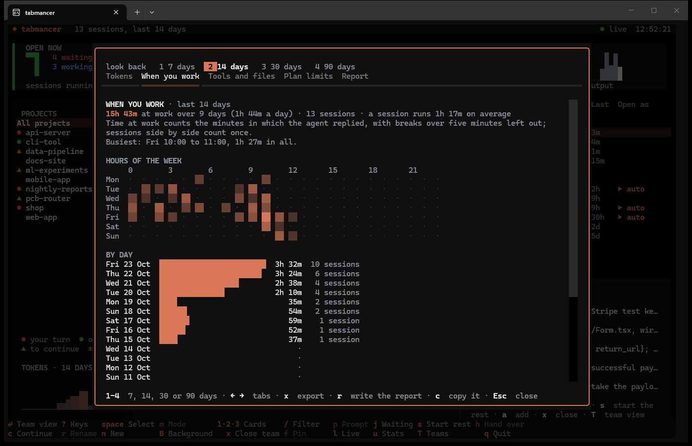
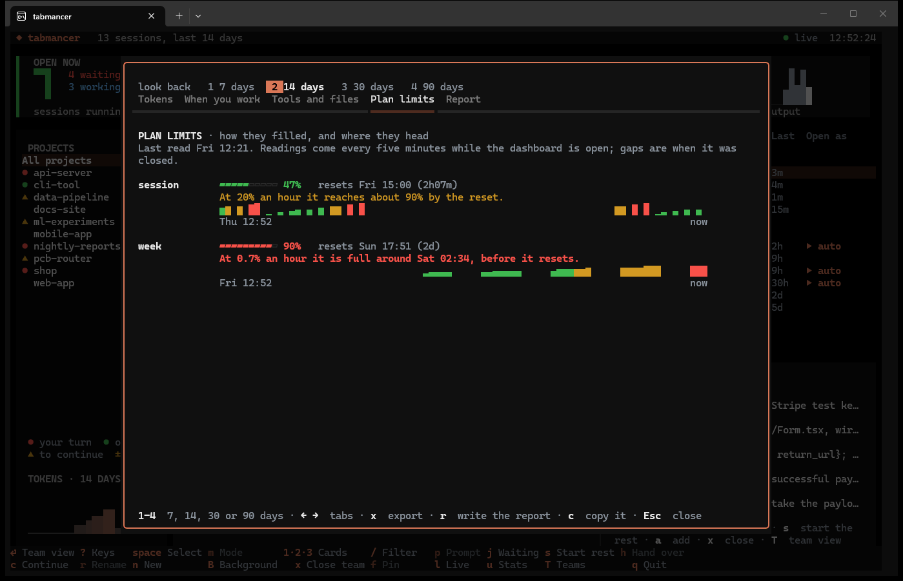
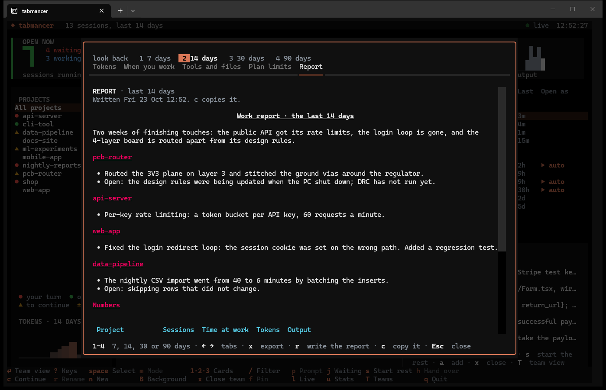
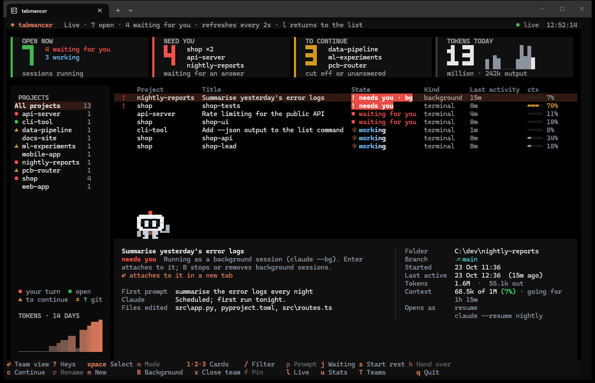

<p align="center">
  
</p>

<p align="center">
  <a href="https://github.com/SinanTufekci/tabmancer/actions/workflows/tests.yml"></a>
  <a href="https://pypi.org/project/tabmancer/"></a>
  
  <a href="LICENSE"></a>
</p>

# tabmancer

A dashboard for your coding-agent sessions, in the terminal: Claude Code first, Codex and
Antigravity if you use them. See every recent session from every project and what the open
ones are doing right now, which one waits for you, and how full each one's context is. Run a
team of sessions that talk to each other. And after a reboot or a crash, call back the
sessions you had open, each in its own tab and folder; the ones cut off mid-reply carry on
by themselves.

<p align="center">
  
</p>

## Quick start

```sh
uv tool install tabmancer    # or: pipx install tabmancer
tabmancer                    # the dashboard
```

`?` lists every key and runs the one you pick; the footer shows the common ones and what
they do on the row you are on. On Windows, `tabmancer shortcut` adds a desktop shortcut and
`tabmancer startup on` opens the picker at login when sessions were left open.

**Contents:** [What it does](#what-it-does) · [Install](#install) · [Keys](#keys) ·
[Teams](#teams) · [Crowded sessions](#crowded-sessions-and-handing-over) ·
[Stats](#stats) · [How it works](#how-it-works) · [Privacy](#privacy) · [Status](#status)

## What it does



- **A dashboard in your terminal.** Live counters for open sessions, sessions waiting
  for you and sessions to continue, a project sidebar with a 14-day token chart,
  spinners on sessions that are working, and colour themes (`t` cycles them). Each counter
  is a filter too: `1` `2` `3`, or a click, shows only what it counts.
- **Your plan limits at a glance.** The top bar shows how full the current session and
  weekly limits are and when they reset. It reads Claude Code's own `/usage` every five
  minutes; that is a local command, not a model call. With Codex on, its limits show too.
- **Stats.** Where the tokens went, when you work (a map of the hours of the week), which
  tools and files, and how fast your plan limits fill, with a forecast of when they run
  out. Over 7 to 90 days, this week against the last, and an export to JSON and CSV.
  Counted from the session files on disk; no model call.
- **A report to share.** Claude writes up what got done and what is open in each
  project over the week, with the numbers, as Markdown you can paste anywhere.
- **Find any conversation.** `/` finds a session by anything you or Claude said in it,
  and the preview shows where.
- **Where each project stands in git.** `±` in the sidebar when a project's folder has
  changes not committed, `↑` when it has commits not pushed; the preview says how many.
- **Every project in one list.** Recent sessions across all your projects, newest first.
  Pick a project in the sidebar to see only its sessions.
- **How each session ended.** Did Claude finish its reply, did you stop it, or was it
  cut off mid-task? Did the process close normally or die?
- **Remembers what was open.** Sessions that were still open at the last shutdown
  start out ticked.
- **A short preview.** First and last prompt, Claude's last reply, files edited, git
  branch, lines changed.
- **No more typing "continue".** A session that was cut off mid-task reopens and is
  told to carry on right away. Sessions stopped at a usage limit show when it lifts,
  and `c` continues them then.
- **Resume, fork or start fresh.** Choose per session.
- **Fresh sessions in several projects at once.** `n` lists the projects you worked in
  lately: tick a few, add a first message if you like, and each opens a clean session
  in its own tab.
- **Teams.** Several sessions on one project, each with its own focus, one of them the
  orchestrator. They message each other, and you watch it happen: the team is one row of
  the list, each member a name with a sign of what it is doing, its preview shows who talks
  to whom, and `T` opens the full view, where every message flies from box to box and the
  conversation is drawn as arrows between the members' lanes. A closed team comes back as
  a team: `Enter` on its row resumes every member as itself.
- **Crowded sessions, handed over.** How full every context is, a word when one passes
  60%, and `h` to move the work to a fresh session with a full handover, when you say so.
- **All at once.** Every chosen session opens in its own tab in one go, in the same
  window. The dashboard stays open in its own tab, so you can come back and open more.
- **Workspaces.** Save a set of project folders ("PCB work") and open them together
  later, from the picker or from their own desktop shortcut.
- **AI summary on demand.** A few sentences on what a session was about and where it
  stopped, written by Claude Code itself.
- **Live view.** See which open sessions are working and which are waiting for you.
  A bell rings when one finishes.
- **Desktop notifications.** When a session stops working and waits for you, or stops
  at a usage limit, and you are not looking at the dashboard, a notification says so.
- **Disk cleanup.** See which sessions take the most space, and move old ones to the
  Recycle Bin.
- **Codex and Antigravity too, if you use them.** Turn them on with `,` and their
  sessions join the list and open in tabs the same way. Only Claude Code is on at first.
- **Hands off your setup.** No hooks and no background service. It writes under
  `~/.claude` only when you ask `tabmancer cleanup` to remove sessions. Its own files
  (workspaces, caches) live in `%APPDATA%\tabmancer`, or in `~/.config/tabmancer` on macOS
  and Linux.

## Install

Requires Python 3.10+ and the Claude Code CLI (`claude`) on your PATH. Tabs open in
Windows Terminal, tmux, WezTerm, kitty, iTerm2, Terminal.app, GNOME Terminal or Konsole.
In any other terminal, tabmancer prints the commands to run.

```sh
uv tool install tabmancer    # or: pipx install tabmancer
tabmancer shortcut           # Windows: adds a "tabmancer" shortcut to the desktop
```

Or run `tabmancer` from any terminal. For the latest from GitHub:
`uv tool install git+https://github.com/SinanTufekci/tabmancer`.

## Keys

The footer shows most keys, on two rows when one is too narrow for them (three in a very
narrow window), so none is cut off. It follows the highlighted row: on a team's row `s` reads
"Start rest" and `x` "Close team", with sessions ticked `Enter` reads "Open 2", and a key that
does nothing on the row is dimmed there (never hidden). The keys keep to the groups `?` shows
them in. `?` lists every key with what it does, and runs the one you pick with `Enter`. Under
the highlighted session the preview says what `Enter` will do with it, as it stands.

| Key | Action |
|---|---|
| `?` | every key, explained; `Enter` runs the one picked |
| `Space`, click `[ ]` | tick / untick a session; on a closed team's row, all its members |
| `Enter` | open the ticked sessions (or the highlighted one if none are ticked); on a team's row, its members, then the team view; on a closed team's row, start the team |
| `j` | go to the next open session waiting for you (again for the one after) |
| `m` | cycle how it opens: resume → auto-continue → fork → new |
| `a` | tick / untick everything visible; on a team's row, add members |
| `/` | find by project, title, or anything said in a session (`Esc` clears) |
| `1` `2` `3`, click a card | only what OPEN NOW, NEED YOU or TO CONTINUE counts; again (or `Esc`) shows all. A click on TOKENS TODAY opens the stats |
| `w` | save the ticked sessions' folders as a workspace |
| `o` | open a workspace (`d` deletes one) |
| `s` | AI summary of the highlighted session; on a team's row, start every member not open |
| `l` | switch to the live view and back |
| `e`, click | open the row to see how the session ended (again to close); on a team's row, its members under it (again to fold) |
| `p` | write a prompt to the highlighted session |
| `n` | start fresh sessions in several projects at once |
| `T` | teams: several sessions on one project with an orchestrator, talking to each other; on a team's row or a member, that team's view |
| `h` | hand a session over to a fresh one; an open one is closed |
| `c` | continue every session stopped at a usage limit when the limit lifts; again cancels (in the footer only while one is) |
| `r` | rename the highlighted session (see below) |
| `x` | hide the ticked sessions, or the highlighted one (in the sidebar: the whole project); nothing is deleted. On an open team's row, twice: close its members' tabs |
| `X` | show the hidden ones too (`x` on one brings it back) |
| `f` | pin the ticked sessions, or the highlighted one, above the rest; again unpins |
| `u` | stats: tokens, when you work, tools and files, plan limits, a written report |
| `B` | background sessions: attach, stop, remove, clean up |
| `,` | which CLIs to list: Claude Code, Codex, Antigravity |
| `t` | next colour theme (remembered) |
| `b` | Bit on or off (remembered) |
| `Tab` | move between the project sidebar and the session list |
| `q`, `Esc` | quit (`Esc` first clears the filter, then a card's) |

**resume** runs `claude --resume <id>`. **auto-continue** resumes and immediately tells
Claude to carry on with the interrupted work, so you do not have to type "continue" in
every tab. It is the default for sessions that were cut off, left unanswered or ended
on an error. **fork** runs `claude --resume <id> --fork-session`, a new session that
starts from a copy of the history. **new** runs a fresh `claude` in that session's folder.
To move a session's work to a fresh one, press `h` (see
[Crowded sessions and handing over](#crowded-sessions-and-handing-over)).

To change what auto-continue says: `tabmancer continue-prompt "Pick up where you left off"`.

`r` renames a Claude Code session the way `/rename` does inside it, so the new name shows
in Claude Code's own `/resume` list too. A closed session runs `/rename` once without a tab
(`claude -p --resume`), which asks no model. An open one has to do it itself, or its next
turn would write the old name back: `/rename` goes to your clipboard and its tab comes to
the front, to paste. Team members keep their names, since the team finds them by it.

## Hide and pin

Old work and test sessions need not crowd the list, and nothing has to be deleted for that.
`x` hides the ticked sessions, or the highlighted one; with a project picked in the sidebar,
it hides the whole project. Hidden ones drop out of the list, the counters and the sidebar,
and are not ticked for reopening; their transcripts stay where they are. The status line
says how many are hidden, `X` lists them too (marked `hidden`), and `x` on one brings it
back. An open session always shows. `f` pins sessions: they stand under **★ PINNED**,
above the rest. Both are kept in `marks.json` in tabmancer's own folder.

## What the status means

| Status | Meaning |
|---|---|
| ● running | open in another terminal right now (cannot be ticked) |
| ◆ background | a background session (`claude --bg`); opening it attaches to it |
| ✓ done | Claude had finished its reply; the session was waiting for you |
| ‖ stopped | you pressed Esc while Claude was replying |
| ▲ cut off | closed while Claude was still working: a tool call or reply was in flight |
| ○ unanswered | your last message never got a reply |
| × error | the last reply was an API error |
| ◐ limit · 16:00 | stopped at a usage limit, which lifts at 16:00 (then: `limit lifted`) |
| × connection lost | the connection to the API dropped, so the reply never came |

A session stopped at a usage limit says when the limit lifts, whether it is still open or
not, and does not count as waiting for you. `c` continues every such session when its limit
lifts (now, if it has): a closed one opens in a new tab, and an open one is closed and
resumed, each told what stopped it. The dashboard has to be open at that time; the plan is
kept if you restart it. Auto-continue tells Claude what stopped the session (a shutdown, a
usage limit or a dropped connection), unless you set a prompt of your own.

The list keeps the open sessions under **OPEN NOW** and the rest under **EARLIER**. For an
open session the **Process** column shows how full its context is. For a closed one it is
empty when the Claude process closed normally (exit, a closed window or an OS shutdown;
the preview says `clean`) and says `killed` when it died without cleaning up (a crash,
power loss, killed from Task Manager). **Open as** is shown only when a session would not
simply be resumed.

Each colour means one thing everywhere: red is your turn (a session waiting for you, and
the NEED YOU card), amber is work to continue (cut off, unanswered, and the TO CONTINUE
card), blue is at work, green is open, grey is done. A state that wants you (needs you, cut
off, unanswered, a limit lifted) is a badge on its own colour; the rest are plain words. The
highlighted row takes the theme's colour. Under the projects, a legend says what their marks
mean. Beside each card's number is what it counts: the open sessions by what they are doing,
the projects waiting for you or with work to continue, and today's tokens hour by hour. In a
window under 40 rows each card is two lines instead, its number and then what it counts, so
the list keeps its room. The top bar shows what the list is narrowed to and how many sessions
are ticked as pills that a narrow window never cuts off.

## Teams



A team is several sessions on one project, each with a focus of its own (the API, the
screens, the tests), and one of them the orchestrator that splits the goal into tasks and
hands them out. Press `T` and give the team a name, a project folder (it completes the
folders you have worked in), a goal and its members, one a line as `name: what they work
on`. The line-ups ready to use (feature team, bug hunt, write and review) are shown by
name, and `Ctrl+T` goes from one to the next. The lead's line is there too: leave it, or
change what it does. `@sonnet` (or any model Claude Code takes) at the end of a line runs
that member on that model, a lead on Opus and the tests on Sonnet, say. Under the form,
what will open is spelled out as you type (the tabs and their names), or what is still
missing. `Enter` and `Tab` go from box to box, and `Ctrl+S` starts the team. `Ctrl+L`
keeps the members in the box as a line-up of your own, under a name; it is then among the
line-ups `Ctrl+T` goes through, and `Ctrl+L` twice on it forgets it.

`Ctrl+B` in the same form runs the members in the background instead (`claude --bg`): no tab
each, only the lead's, where you talk to the team. The members start first, the lead's tab
opens once they are up, and `B` lists them. `x` twice on the team stops them (`claude stop`;
their sessions stay), and `s` starts them in the background again.

Or let the lead decide: with the line-up **lead decides**, only the lead starts. It reads
the goal, looks at the project and picks the members the work needs, up to the limit you
set (4 unless you change it), fewer when the work is small: their names, their areas and,
when it matters, their models. It adds them with one command,
`tabmancer team add <team> "name: area @model; name: area"`, the only command it may run
without asking you (`--allowedTools=...,Bash(tabmancer team add:*)`). Each member opens in
its own tab (or, with `Ctrl+B`, in the background) and introduces itself to the lead, and the
team view shows them join.



While any of its members is open, the team heads OPEN NOW in the dashboard's own list, as
one row: the team's name, then each member's name with a sign of what it is doing (red `●`
when it waits for you, `!` when it needs you, Claude's turning star while it works, `▲` when
it was cut off), what the open ones are doing in all, and the tokens it has used. When the
names do not fit, the quietest are counted (`+2`, red if one of them waits for you too), so
whoever waits for you stays named. `j` goes to the next member waiting for you and shows its
team's members. With the team's row highlighted, the preview shows who talks to whom: each
member on its wire from the lead, with the count of messages sent along it both ways and the
latest one beside it, and a message flying along the wires as it is sent. From 150 columns
the newest messages are listed beside it.

`Enter` (or `e`) unfolds the team: its members hang under its row as a tree, the lead first,
each with the latest message to or from it, and `Enter` again opens the team view. A
member's row is an ordinary session row (`Enter`, `h`, `p` and the rest work as on any
other), and its preview says how many messages it got and sent. On the team's row, `s`
starts every member that is not open, `a` adds members (each opens and introduces itself to
the lead) and `x` twice closes the members' tabs.

A team whose members are all closed, after a restart say, stays a team: its row sits among
the closed sessions where it last worked, with a box to tick the whole team. `Enter` on it
starts the team: each member resumed as itself, the lead last, so the others are up when it
starts handing out work. A member opened any other way (ticked and opened, `p`, `c`, a
workspace) also comes back with its name, its role and the setting that lets the team's
messages in; a plain `claude --resume` would leave all three out. Members added to a closed
team wait to start with it.

Every member is an ordinary Claude Code session in its own tab, so it can be closed,
resumed and handed over like any other. Each starts with:

- a name (`--name shop-api`), which is how the others address it;
- its model (`--model sonnet`), if the line-up gave it one;
- its role, added to the system prompt (`--append-system-prompt`): its focus, the other
  members and who the orchestrator is;
- a setting that lets messages from the other sessions in (`--settings`, a small file of
  tabmancer's own: your settings are not touched).

They talk with Claude Code's own messaging between sessions: a member calls `SendMessage`
with another member's name, and the message arrives there as a new turn, even if that
session was idle. tabmancer never carries a message; it reads them back from the
transcripts to draw the team view:

- the orchestrator on top and the members below, each box with the member's focus, what it
  is doing (working, waiting, needs you), the tokens it has used, how full its context is,
  and how many messages it has not read. The boxes grow with the window;
- beside the wire down to each member, how many messages went down it and back up
  (`3▼ 2▲`), and the latest of them;
- every new message flying along the wires from sender to receiver, then spelled out
  underneath;
- the conversation as a sequence diagram: a lane for each member (yours on the left), and
  for each message an arrow from the sender's lane to the receiver's, with what it said
  beside it. A message still on its way is a dashed arrow, and a new day is named. The
  prompts tabmancer starts members with are drawn as tabmancer's, quieter than yours.

`T` on a team's row in the list, or on one of its members, opens that team's view
straight away; elsewhere it lists the teams, to pick one or start a new one. `←` `→` pick
a member: its box, its lane and its arrows stay lit and the rest go quiet; past the last
member everyone is lit again. `Enter` goes to the member's tab (or opens it if it is
closed), `s` starts every member that is not open, and `a` adds members, who introduce
themselves to the orchestrator. `d` twice takes the picked member off the team (never the
lead); its sessions stay, as ordinary ones. `g` changes the team's goal; members started
from then on get it in their role. An open lead started with the old line-up or goal, so
either way a note for it goes to the clipboard and you to its tab, to paste it. `x` twice
closes the whole team: every open member's tab, Claude exiting as on `/exit`, so `s` starts
them again later. Under the goal, the tokens the team has used, and each member's.

## Crowded sessions and handing over

A session whose context fills up gets slow, costly and forgetful. tabmancer shows how full
each one is: a bar and `73%` beside every open session, and the size against the model's window
(200K, or 1M for the models that have it) in the preview. It is worked out the way Claude
Code's own statusline does it, from what the last reply was sent with.

Past 60% (set `TABMANCER_CONTEXT_WARN` to change it) the dashboard says so, once per
session: "web-app has been going for 6h 12m and its context is 73% full. /compact in its tab
goes on with the same work; h starts a new phase in a fresh session, and shows what is handed
over." The preview says the same in a line under the context, `/compact: go on · h: new
phase`, for as long as the session stays that full. It never does anything about it by itself.

When you decide to, press `h`. A fresh session takes over in the same folder, with a full
handover as its first message: the goal, the decisions and why, what is done, what is open
or broken, the gotchas and the next steps. Nothing is written to a file. The handover
comes from one of two places:

- **The session itself** (`Enter`), which knows everything, so this is the most complete.
  It is resumed once in the background, without a tab (`claude -p --resume`), writes the
  handover and exits. Nothing to paste. It reads its whole context back to do so, which
  takes a minute or two for a crowded one.
- **The transcript** (`↓ Enter`), cheaper: Claude (`claude -p --model sonnet`) writes it
  from your messages, Claude's last replies, the files edited and the commits made. It
  cannot know what was never written down, so prefer the first.

An open session is closed on the way: tabmancer closes its Windows Terminal tab, and
Claude Code exits as it does on `/exit`, so you can still resume it later. Closing a tab
works in Windows Terminal only for now; elsewhere, close the session yourself (`/exit`)
and press `h` on it then. Only a session that waits for you is closed. `h` on one that is working queues the handover:
**Open as** says `▶ hand over`, it happens as soon as the session finishes, and `h` again
cancels it. One whose tab cannot be told apart from another of the same title is left
alone: close it yourself (`/exit`), then press `h` again.

To go on with the same work instead, `/compact` in the session's own tab shrinks its
context in place: it fits carrying on, `h` fits a new phase, a closed session, or wanting to
read what is passed on.

A team member handed over (`h` in the team view as well) comes back with the same name and
role, so the rest of the team reaches the new session.

## Fresh sessions

A long conversation carries its whole history into every turn, so starting clean is
often the better move. Press `n`:

- The projects you worked in lately are listed, newest first, with the folders of your
  workspaces. Type to filter them, or type any folder path to add it.
- `Space` ticks a project. Write a first message if you want one: every new session
  gets it, so they all start working right away.
- `Enter` opens a fresh session in each ticked folder, each in its own tab.
- With more than one CLI on, `Ctrl+O` picks which one to start.

These start clean. To carry a session's work on in a fresh one, hand it over with `h`
instead (see [Crowded sessions and handing over](#crowded-sessions-and-handing-over)).

From a shell or a script:

```sh
tabmancer new web-app api-server --prompt "Run the tests and fix what fails"
tabmancer new C:\dev\new-idea --cli codex
```

A name is matched against the projects you worked in lately; a path works anywhere.

## Workspaces

A workspace remembers folders, not sessions. Session ids go stale as soon as you
`/clear` or start a new session. Opening a workspace therefore continues the most
recent session in each folder, the way `claude --continue` would. A folder saved
twice continues its two most recent sessions. Sessions that are already open count,
so nothing opens twice. Rows set to **new** in the picker are saved as "start a fresh
session here".

```sh
tabmancer open "PCB work"                    # open it without the picker
tabmancer workspaces                         # list them (--delete NAME to remove one)
tabmancer shortcut --workspace "PCB work"    # Windows: a desktop shortcut for it
```

## Other commands

```sh
tabmancer list           # print recent sessions; * marks the ones open at the last shutdown
tabmancer list --json    # the same as JSON
tabmancer stats          # tokens, working hours, tools and limits (--json, --csv)
tabmancer report         # a report of the week, written by Claude (--save)
tabmancer --days 30      # look further back (default 14)
tabmancer --all          # include claude -p, desktop app and IDE sessions
tabmancer doctor         # check that everything tabmancer relies on still works
```

Run `tabmancer doctor` after a Claude Code update if something looks off. It checks the
CLI, how open sessions are detected, the terminal, and whether recent transcripts still
read as expected.

## Desktop notifications

While the dashboard is open, a session that stops working and waits for you (or stops at
a usage limit) is also told by a desktop notification, unless you are looking at the
dashboard. Several at once come as one notification.

On Windows a Windows toast shows it (it says it comes from Windows PowerShell, whose app id
it borrows so that nothing has to be installed). Whether you are looking is asked of
Windows itself: the window in front is Windows Terminal with the dashboard's tab selected.
macOS uses `osascript` and Linux `notify-send`, when the terminal reports that the dashboard
is not focused.

```sh
tabmancer notifications          # on or off
tabmancer notifications off      # and on again with: on
tabmancer notifications test     # show one now
```

## Start at login

```sh
tabmancer startup on       # also: off, status
```

At login a windowless check runs. If sessions were left open at the last shutdown, the
picker opens with them ticked, in a terminal window of its own; if none were, nothing
appears. On Windows this is a shortcut in your Startup folder, on macOS a LaunchAgent
(`~/Library/LaunchAgents/com.tabmancer.startup.plist`) whose picker opens in Terminal, and on
Linux an autostart entry (`~/.config/autostart/tabmancer.desktop`) whose picker opens in the
first terminal found (x-terminal-emulator, GNOME Terminal, Konsole, kitty, WezTerm, ...).

## Free disk space

```sh
tabmancer cleanup
```

Lists every session on disk, biggest first. A session's size counts its transcript, its
folder of subagent transcripts, and its file snapshots for rewind. Tick sessions with
`Space`, or press `o` to tick everything older than a week. `Enter` moves them to the
Recycle Bin (Trash on macOS and Linux), so a mistake can be undone. Sessions that are
open right now cannot be ticked.

Claude Code already deletes sessions older than `cleanupPeriodDays` (30 by default) on
its own. This is for the big ones in between.

## Write to a session

Press `p` on a session and type what Claude should do next.

- **Enter** opens the session in a new tab with your prompt already sent
  (`claude --resume <id> "<prompt>"`).
- **Ctrl+B** runs it in the background instead (`claude --bg --resume <id> "<prompt>"`). The
  dashboard shows it working and tells you when it needs you. `Enter` on it attaches.
  `B` stops or removes it when you are done (see [Background sessions](#background-sessions)).

The dashboard stays open either way, so you can write to several sessions in a row.

A session that is already open in another tab cannot be written to from outside, so for
those `p` (or `Enter`) takes you there instead. It selects that session's tab and brings
its window to the front, ready for you to type: in Windows Terminal, in tmux (the pane
whose title is the session's), and on macOS in iTerm2 and Terminal. The tab is found by
its title, which Claude Code sets to the session's name.

Click a session, or press `e`, to open its row and see what it came to: Claude's answer
for a finished session, the question left hanging for a cut-off one, or the AI summary
once one exists. Click it again to close it. Clicking its `[ ]` box ticks it instead.
Opened rows stay open while the list updates.

## Background sessions

A background session (`claude --bg`) keeps its process running after Claude has
finished, waiting for a next message, and Claude Code keeps its entry after the process
ends. Both pile up. Press `B` to see every background session Claude Code knows:

- **Enter** attaches to it in a new tab (`claude attach <id>`).
- **x** stops it (`claude stop <id>`). Its conversation is kept, and attaching starts it
  again. A session that is working or waiting for an answer asks you to press `x` twice.
- **d** removes it (`claude rm <id>`), after a second press. That deletes the entry and
  its worktree. The transcript stays, so the session is still in the list and can be
  resumed. If the worktree has unpushed commits, Claude Code does not discard them; it reports them instead.
- **c** cleans up: it removes every background session that is idle or has stopped,
  after a second press. Sessions that are working or waiting for you are left alone.

Bit mentions it when background sessions sit idle.

## Codex and Antigravity

tabmancer is built around Claude Code, and lists only its sessions until you say
otherwise. If you also use OpenAI's Codex CLI or Google's Antigravity CLI (`agy`), press
`,` and turn them on, or run:

```sh
tabmancer clis                    # which are on, and where each one is installed
tabmancer clis enable codex agy   # or: disable
```

Their sessions then join the list, the project sidebar and the counters, with the CLI's
name in the Process column. They open in tabs like Claude Code's, with that CLI's own
commands: `codex resume <id>` or `agy --conversation <id>`, and a fresh `codex` or `agy`
for **new**. Each CLI keeps its sessions in its own format, so what tabmancer can show
differs:

| | Claude Code | Codex | Antigravity |
|---|---|---|---|
| How it ended, last prompt and reply | ✓ | ✓ | title only |
| Resume, auto-continue, new | ✓ | ✓ | ✓ |
| Fork | ✓ | ✓ | |
| Open right now, background sessions | ✓ | | |
| Tokens, time at work, tools in the stats | ✓ | ✓ | |
| AI summary | ✓ | ✓ | |

With Codex on, its plan limits show beside Claude's: in the top bar, in the Plan limits
tab and its forecast. Codex has no command to ask, so they come from what its latest turn
wrote into its session files.

Codex sessions started by `codex exec` are left out like `claude -p` ones; `--all`
brings them in. Antigravity keeps its conversations in a binary format, so only their
index (title, folder, time) can be read. Neither of the two says when a session is open,
so tabmancer cannot stop you from opening one twice.

## Bit

A little robot of our own walks along the top edge of the preview, below the list: a
head with a beacon on top and a dark visor, a body with a light on its chest, two arms
and two legs. It takes up four rows and has no box of its own: around it is the list's
background.

Bit is pixel art. In Windows Terminal each cell holds 2x4 pixels (Unicode block
octants), so Bit is 22x15 pixels in a space eleven cells wide (the outer cells are for
its arms, raised). It is drawn to the cell grid, so no cell has to show more than the two
colours a terminal cell can, in any pose, and it moves up or down only a whole cell at a
time: a hop lifts it one cell. Other
terminals get half blocks, which every font has. Set `TABMANCER_MASCOT_BLOCKS` to
`octants` or `half` to choose. Frames that have not changed
are not redrawn.

What Bit does follows what the sessions do:

- While sessions work, it works too, eyes down and hands quick, and hurries about; its
  chest light pulses quickly.
- While a session needs you (a question to answer), it stays put and calls you: it waves
  with its eyes wide every few seconds, and its beacon blinks red, for as long as it
  lasts.
- When nothing happens, it wanders slowly, sits, and in the end dozes off with drifting
  Z's and its eyes closed.

It walks with its feet lifting in turn and its arms swinging, looks around, waves, hops
and blinks. Its eyes follow the mouse pointer. It talks in a bubble beside it:

- It greets you, saying how many sessions were open at the last shutdown.
- It cheers with confetti when a session finishes ("web-app is done!").
- It throws red sparks when one needs you.
- It warns when a usage limit passes 85 %.
- Click it for a tip about the keys; click it again and again and its head spins.

Press `b` to hide Bit, or to bring it back.

## AI summaries

Press `s` on a session. tabmancer sends a digest of it to Claude and shows what comes back.
The digest holds your messages, Claude's last three replies and the names of edited files.
It is sent with:

```sh
claude -p --model haiku --tools "" --no-session-persistence
```

That uses whatever Claude Code is logged in with: your plan's usage, or your API key.
It takes no tools and leaves no transcript behind. Each summary is cached until the
session changes, so viewing it again costs nothing. Set `TABMANCER_SUMMARY_MODEL` to use
another model.

## Stats

Press `u` for the stats. `1` to `4` look back 7, 14, 30 or 90 days, `←` `→` move between
the five tabs, and `x` saves everything as JSON and CSV in your Downloads folder.

**Tokens.** Today, this week and the whole period; this week against the last (tokens,
output, time at work, sessions); then by day, project, session and model.



**When you work.** Time at work over the period and per day, a map of the hours of the
week, how long sessions run, and the longest ones. Time at work counts the minutes in
which the agent replied; a gap of more than five minutes is a break, and sessions running
side by side count once on the clock.



**Tools and files.** Which tools were called most (MCP tools count per server), the
files edited most, and lines added and removed per project.

**Plan limits.** While the dashboard is open it reads your limits every five minutes and
keeps each reading. This tab charts the session limit over the last day and the weekly
one over the last week, and says how fast each one fills: "At 0.7% an hour it is full
around Sat 07:54, before it resets", or where it will stand at the reset.



**Report.** Press `r` and Claude writes a report of the period to share with your team:
a few sentences on the period, then what got done and what is still open in each
project, in the language you write your prompts in. The numbers at the end (sessions,
time at work, tokens per project) come from the stats; the model only translates the
table's header, and if it changes a number its table is replaced with tabmancer's own.
The report is saved as Markdown in your Downloads folder, and `c` copies it.



The report is one `claude -p --model sonnet` call on your plan, with no tools. Only what
the session list shows is sent: titles, first and last prompts, last replies or AI
summaries, file names and line counts. It is cached until those change. Set
`TABMANCER_REPORT_MODEL` to use another model. It reads everything the sessions were
about, so look it over before it goes beyond your team.

From a shell:

```sh
tabmancer report                # the last 7 days, as Markdown (--days 14, --save)
tabmancer stats                 # all four, as text
tabmancer stats --days 30 --json
tabmancer stats --csv > days.csv   # one row per day: sessions, minutes, tokens
tabmancer tokens                # only the tokens
```

### How tokens are counted

The **TOKENS TODAY** card counts what every session used today, with a bar for each hour
beside the number (the hour now in white), and the chart under the
project list shows the last 14 days, for the project you pick there. The preview shows
each session's total.

The counts come from the usage figures Claude Code writes into each transcript with
every reply, subagents included (and from Codex's running totals, if Codex is on). A
reply that a forked session copied from its parent is counted once. They cover all four
kinds of tokens:

- **cache reads**: the conversation so far, read back on every turn. Long sessions
  are mostly this.
- **cache writes**: new context, written to the cache for the next turn.
- **fresh input**: input sent without the cache.
- **output**: what Claude wrote, its thinking included.

The totals show where the work went. How much of your plan's limits that used is what
the top bar and the Plan limits tab show.

Each session file is read once. After that, only what was added since is read, so the
count stays current every minute at next to no cost.

## Live view



`tabmancer live`, or `l` in the picker, lists only the sessions that are open right now.
It refreshes every few seconds and sorts them by what needs you first:

- **needs you**: a background session reports that it is blocked
- **waiting for you**: Claude finished and the session is idle
- **working**: Claude is busy. If it has written nothing for five minutes, the row adds
  "quiet", which usually means a long command or an unanswered permission prompt.

The dashboard stays live in both views. Every two seconds it reads Claude Code's
live-session files, which costs next to nothing. Every 16 seconds it also asks
`claude agents --json`, which covers background sessions and notices sessions that
have closed. When a session goes from working to waiting, a note pops up. In the live
view the terminal bell rings as well.

## How it works

Claude Code stores each session as a JSONL transcript under
`~/.claude/projects/<project>/<session-id>.jsonl` (or under `CLAUDE_CONFIG_DIR`).
tabmancer reads the start and end of each recent transcript:

- The last conversation record tells how the session ended. For example, a tool call
  with no result means it was cut off mid-task.
- Claude Code writes a final bookkeeping record when it exits normally. If that record
  is missing, the process was killed.
- Sessions that are open right now come from `claude agents --json`. If the CLI is
  missing or too old, they come from Claude Code's live-session files in
  `~/.claude/sessions` instead.
- Shutdown times come from the System event log on Windows, from the journal (each
  earlier boot's last entry) or else wtmp on Linux, and from `last` on macOS. A session
  whose last write lands moments before a shutdown counts as open at that shutdown. Where
  none can be read, sessions that ended within the same minute or two count instead.

Parsed results are cached by file size and modification time, so the list opens
instantly. The first run reads each recent transcript once.

The transcript format is internal to Claude Code and can change between releases.
tabmancer reads it defensively: a field it cannot read shows up empty instead of
crashing the picker. `tabmancer doctor` notices when too many fields come up empty.

## Status

Early (0.1). It is built and used daily on Windows 11 with Windows Terminal, and the
tests run on Windows and Linux.

On macOS and Linux it has not been used day to day yet. What is known:

- The dashboard itself is plain Textual and runs anywhere Python does.
- Opening tabs in tmux, WezTerm, kitty, iTerm2, Terminal.app, GNOME Terminal and Konsole is
  covered by unit tests but has not been tried by hand.
- The shutdown times (the journal, wtmp) and focusing a session's pane in a real tmux server
  run for real in the Linux tests. Start at login writes its autostart entry in the tests
  too, but neither the entry nor the picker's terminal window has been tried at an actual
  desktop login, nor have the desktop notifications (`notify-send`).
- Nothing has been tried on a real Mac: the LaunchAgent, `last`'s output there, the
  AppleScript that finds a tab in iTerm2 or Terminal, and the notifications through
  `osascript` are written to their documentation and unit-tested with the commands stubbed.
- Closing a session's tab (for a handover of an open session) is Windows Terminal only.

Reports are welcome.

The pictures are of a real Windows Terminal window over made-up sessions:
`uv run --with pillow python scripts/window_shots.py <folder>` takes them and
`scripts/readme_media.py <folder>` turns them into the PNGs and `docs/demo.webp`;
`uv run --with pillow --with websockets python scripts/promo.py` draws the banner.

## Privacy

tabmancer runs on your machine and talks to no server of its own. It reads the transcripts
the agents already keep (`~/.claude`, `~/.codex`, `~/.gemini`) and asks the `claude` CLI
which sessions are open and how full your plan limits are (`/usage`, a local command). A model
is called only when you ask for one, through your own CLI
and plan: an AI summary (`s`), a handover (`h`), a report (`r` in the stats). Nothing is
sent anywhere else, and there is no telemetry.

## Trademarks

tabmancer is an independent project, not made by, affiliated with or endorsed by
Anthropic, OpenAI or Google. Claude Code, Codex and Antigravity are their owners'
trademarks; they are named here only to say what tabmancer works with.

## License

MIT. Not affiliated with Anthropic.
