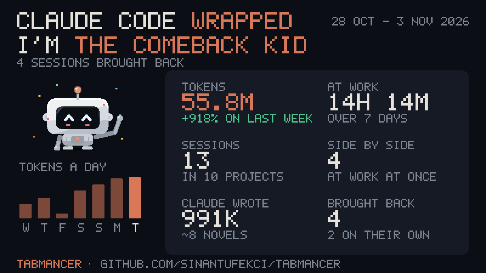
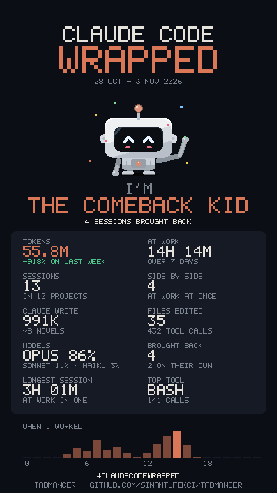

<p align="center">
  
</p>

<p align="center">
  <a href="https://github.com/SinanTufekci/tabmancer/actions/workflows/tests.yml"></a>
  <a href="https://pypi.org/project/tabmancer/"></a>
  
  <a href="LICENSE"></a>
</p>

# tabmancer

**Many Claude Code sessions in many terminals: one screen for all of them, and none lost.**
tabmancer is a dashboard for your coding-agent sessions, in the terminal. See every session
from every project, which ones are working, which one waits for you and how full each one's
context is, and go to any of them in a key. Close them when you have to, even halfway through
a task: they come back where they left off, each in its own tab and folder, and the ones cut
off mid-reply carry on by themselves. Claude Code first, Codex and Antigravity if you use them.

> I run Claude Code in several terminals at once, and keeping track of them got hard: which
> one is working, which one is waiting for me. And I often had to close them before Claude
> had finished. tabmancer is what I built for both: one screen to see and manage them all,
> and every session back where it left off, all of them at once. *Sinan Tüfekci*

<p align="center">
  
</p>

## Try it

```sh
uvx tabmancer --demo         # made-up sessions: nothing of yours is read or changed
```

Every key works in the demo, but nothing opens and no model is asked. Then install it:

```sh
uv tool install tabmancer    # or: pipx install tabmancer
tabmancer                    # the dashboard
```

It needs Python 3.10+ and Claude Code's `claude` on your PATH. Upgrade it with
`uv tool upgrade tabmancer` (or `pipx upgrade tabmancer`): the dashboard says when a newer
version is out ([updating](docs/setup.md#updating)). `?` lists every key and runs
the one you pick; the footer shows the common ones and what they do on the row you are on.
On Windows, `tabmancer shortcut` adds a desktop shortcut and `tabmancer startup on` opens the
picker at login when sessions were left open.

## What it does


- **Shows what each one is doing.** Every open session, whichever terminal it is in: working,
  waiting for you or needing you, and how full its context is; your plan limits in the top bar.
  `j` goes to the next one waiting for you, and `Enter` on an open one goes to its tab.
- **Brings your sessions back.** Closed before they were done, by you, a reboot or a crash,
  they say how they ended (cut off, unanswered, at a usage limit, done) and wait under TO
  CONTINUE. `Enter` opens them again where they left off, each in its own tab and folder, and
  the ones cut off mid-task are told to carry on. After a reboot the ones that were open start
  out ticked: one `Enter` brings them all back. Resume, fork or start fresh, per session.
- **Gets past a usage limit.** Sessions stopped at a limit say when it lifts; `c` continues
  them all then, or right away once you have signed in with another account.
- **Runs teams.** Several sessions on one project with an orchestrator, talking through Claude
  Code's own messaging between sessions: one row in the list, and a view of who tells whom what.
- **Hands crowded sessions over.** `h` moves the work to a fresh session, with a full handover
  as its first message.
- **Counts.** Tokens, when you work, tools and files, plan limits with a forecast, and a
  written report of the week to share.
- **Wraps your week up.** [Claude Code Wrapped](#claude-code-wrapped): your week as a card to
  post on X, Bluesky, Threads or your Instagram story.
- **Finds.** `/` finds a session by anything you or Claude said in it.
- **Codex and Antigravity too**, if you use them.

[Everything it does](docs/features.md), and the details: [using it](docs/using.md) (what each
status means, every key, writing to a session, background sessions, workspaces) ·
[teams](docs/teams.md) · [handing over](docs/handover.md) · [stats and reports](docs/stats.md) ·
[setup and commands](docs/setup.md) · [how it works](docs/how-it-works.md)

## Claude Code Wrapped

<p align="center">
  
  
</p>

Your week with Claude Code as a card worth posting, drawn in pixels like Bit. On Fridays Bit
says it is ready, and `W` shows it any day: who the week made you (the Conductor, the Night
Owl, the Marathoner, the Comeback Kid and more, each with the number behind it), the tokens
against last week, the time at work, the sessions side by side, what Claude wrote in novels'
worth, the files edited, the models, the longest session and the hours you worked. `f` turns it
into a story card. `p` shares it: X, Bluesky or Threads open a new post with the words already
written and the card on your clipboard to paste in; for Instagram the story card is saved and
its folder opened, to send to your phone. Nothing is posted until you post it, and the card
holds counts only: no project names, nothing said in a session.

```sh
tabmancer wrapped --share x    # or bluesky, threads, instagram; --story saves the tall card
```

## Keys

| Key | Action |
|---|---|
| `Enter` | open the ticked sessions, or the highlighted one, each in its own tab |
| `Space` | tick a session |
| `m` | how it opens: resume → auto-continue → fork → new |
| `p` | write a prompt to a session (an open one: go to its tab) |
| `j` | the next open session waiting for you |
| `/` | find by project, title, or anything said in a session |
| `n` | fresh sessions in several projects at once |
| `T` | teams |
| `h` | hand a session over to a fresh one |
| `c` | continue the sessions stopped at a usage limit |
| `u` | stats |
| `W` | Claude Code Wrapped: your week as a card; `p` shares it, `f` makes it a story |
| `?` | every key, explained; `Enter` runs the one picked |

[All the keys](docs/using.md#keys).

## Where it runs

Built and used every day on Windows 11 with Windows Terminal: tabs, going to a session's tab,
start at login, desktop notifications and a desktop shortcut. On Linux, tabs open in tmux
(tried for real), WezTerm, kitty, GNOME Terminal and Konsole; on macOS in iTerm2 and
Terminal.app, which have not been tried on a real Mac yet. In any other terminal, tabmancer
prints the commands to run. [What has been tried where](docs/how-it-works.md#status).
Reports are welcome.

Claude Code's formats are its own and can change between releases: after an update,
`tabmancer doctor` checks that everything tabmancer relies on still works.

## Privacy

tabmancer runs on your machine and talks to no server of its own. It reads the transcripts
the agents already keep (`~/.claude`, `~/.codex`, `~/.gemini`) and asks the `claude` CLI
which sessions are open and how full your plan limits are (`/usage`, a local command). It
reads which account you are signed in with (its email and plan) from `~/.claude.json` and
Codex's `auth.json`, to show it in the top bar, and remembers the emails of the Claude accounts it
has seen, in its own folder, to offer them when you switch (`A`), and the ids of the sessions it
opened again, to count them on your week's card (`W`). Once a day it asks PyPI which version of
tabmancer is the latest, to tell you of a newer one (`tabmancer updates off` stops it). A model
is called only when you ask for one, through your own CLI
and plan: an AI summary (`s`), a handover (`h`), a report (`r` in the stats). It types into
an open session only when you have it continue the ones stopped at a usage limit (`c`).
Sharing your week's card (`p` on it) opens the platform's own page for a new post in your
browser, with the words written in: you post it, or not.
Nothing is sent anywhere else, and there is no telemetry.

## Trademarks

tabmancer is an independent project, not made by, affiliated with or endorsed by
Anthropic, OpenAI or Google. Claude Code, Codex and Antigravity are their owners'
trademarks; they are named here only to say what tabmancer works with.

## License

The code is licensed under the [Apache License 2.0](LICENSE): keep the [NOTICE](NOTICE) with it and credit "tabmancer by Sinan Tüfekci". Bit, the robot, is licensed under [CC BY 4.0](LICENSE-BIT): wherever you use it, credit "Bit by Sinan Tüfekci". Not affiliated with Anthropic.
