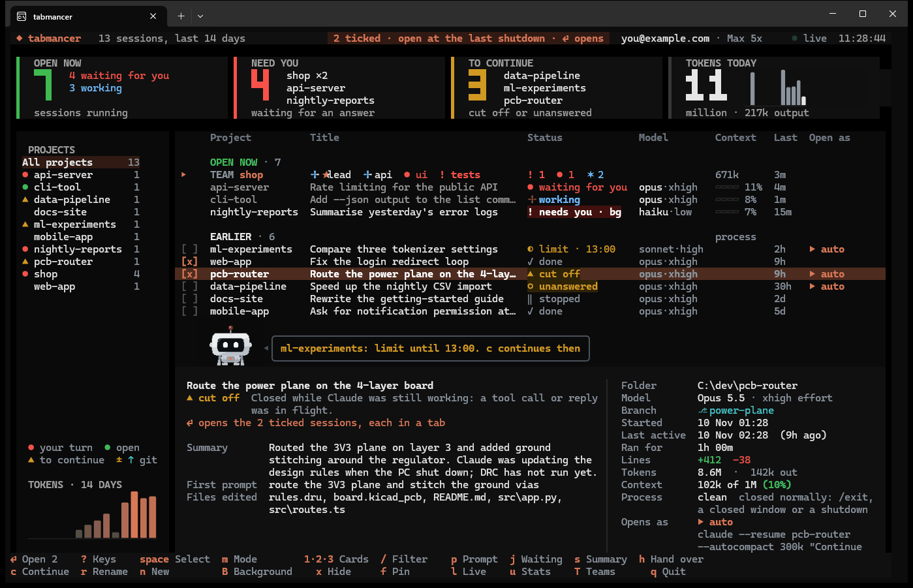

# What tabmancer does

[← tabmancer](../README.md)

- **A dashboard in your terminal.** Live counters for open sessions, sessions waiting
  for you and sessions to continue, a project sidebar with a 14-day token chart,
  spinners on sessions that are working, and colour themes (`t` cycles them). Each counter
  is a filter too: `1` `2` `3`, or a click, shows only what it counts.
- **Your plan limits at a glance.** The top bar shows how full the current session and
  weekly limits are and when they reset. It reads Claude Code's own `/usage` every five
  minutes; that is a local command, not a model call. With Codex on, its limits show too.
- **Stats.** Where the tokens went, when you work (a map of the hours of the week), which
  tools and files, and how fast your plan limits fill, with a forecast of when they run
  out. Over 7 to 90 days, this week against the last, and an export to JSON and CSV.
  Counted from the session files on disk; no model call.
- **A report to share.** Claude writes up what got done and what is open in each
  project over the week, with the numbers, as Markdown you can paste anywhere.
- **Find any conversation.** `/` finds a session by anything you or Claude said in it,
  and the preview shows where.
- **Where each project stands in git.** `±` in the sidebar when a project's folder has
  changes not committed, `↑` when it has commits not pushed; the preview says how many.
- **Every project in one list.** Recent sessions across all your projects, newest first.
  Pick a project in the sidebar to see only its sessions.
- **How each session ended.** Did Claude finish its reply, did you stop it, or was it
  cut off mid-task? Did the process close normally or die?
- **Remembers what was open.** Sessions that were still open at the last shutdown
  start out ticked.
- **A short preview.** First and last prompt, Claude's last reply, files edited, git
  branch, lines changed.
- **No more typing "continue".** A session that was cut off mid-task reopens and is
  told to carry on right away. Sessions stopped at a usage limit show when it lifts;
  `c` continues them then, or right away once you have signed in with another account.
- **Resume, fork or start fresh.** Choose per session.
- **Fresh sessions in several projects at once.** `n` lists the projects you worked in
  lately: tick a few, add a first message if you like, and each opens a clean session
  in its own tab.
- **Teams.** Several sessions on one project, each with its own focus, one of them the
  orchestrator. They message each other, and you watch it happen: the team is one row of
  the list, each member a name with a sign of what it is doing, its preview shows who talks
  to whom, and `T` opens the full view, where every message flies from box to box and the
  conversation is drawn as arrows between the members' lanes. A closed team comes back as
  a team: `Enter` on its row resumes every member as itself.
- **Crowded sessions, handed over.** How full every context is, a word when one passes
  60%, and `h` to move the work to a fresh session with a full handover, when you say so.
- **All at once.** Every chosen session opens in its own tab in one go, in the same
  window. The dashboard stays open in its own tab, so you can come back and open more.
- **Workspaces.** Save a set of project folders ("PCB work") and open them together
  later, from the picker or from their own desktop shortcut.
- **AI summary on demand.** A few sentences on what a session was about and where it
  stopped, written by Claude Code itself.
- **Live view.** See which open sessions are working and which are waiting for you.
  A bell rings when one finishes.
- **Desktop notifications.** When a session stops working and waits for you, or stops
  at a usage limit, and you are not looking at the dashboard, a notification says so.
- **Disk cleanup.** See which sessions take the most space, and move old ones to the
  Recycle Bin.
- **Codex and Antigravity too, if you use them.** Turn them on with `,` and their
  sessions join the list and open in tabs the same way. Only Claude Code is on at first.
- **Hands off your setup.** No hooks and no background service. It writes under
  `~/.claude` only when you ask `tabmancer cleanup` to remove sessions. Its own files
  (workspaces, caches) live in `%APPDATA%\tabmancer`, or in `~/.config/tabmancer` on macOS
  and Linux.
