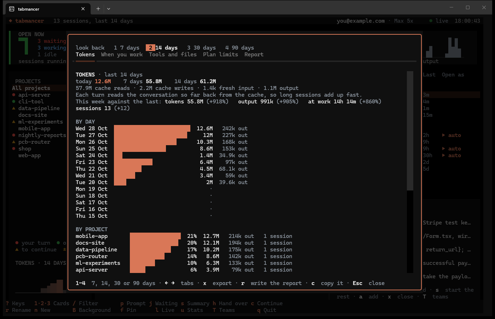
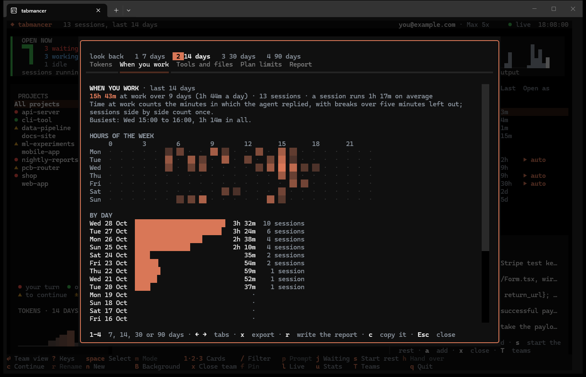
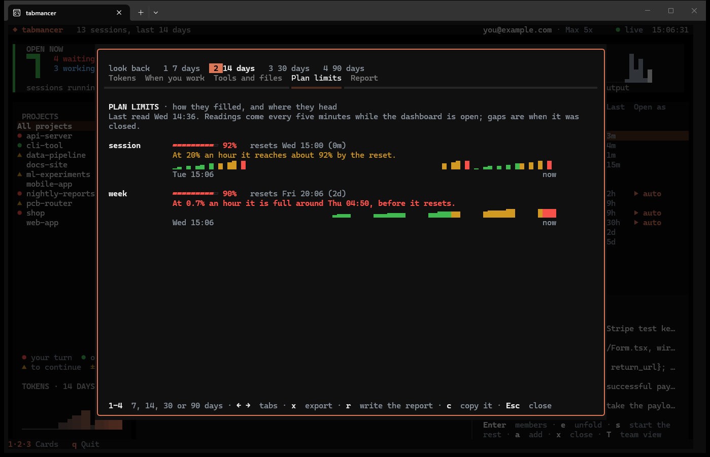
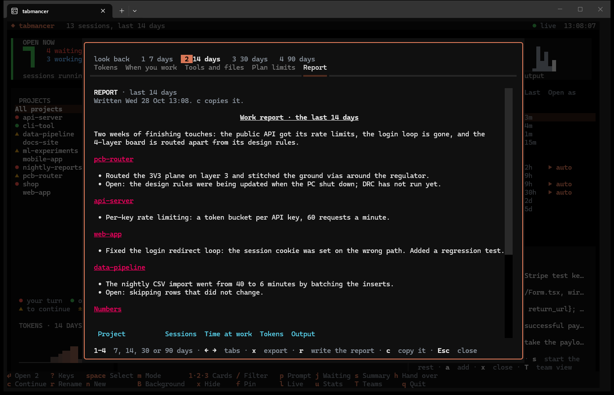

# Stats, reports and summaries

[← tabmancer](../README.md)

## Stats

Press `u` for the stats. `1` to `4` look back 7, 14, 30 or 90 days, `←` `→` move between
the five tabs, and `x` saves everything as JSON and CSV in your Downloads folder.

Where the terminal draws Bit in real pixels (Sixel or kitty graphics), the bar charts and the
map of the hours of the week are drawn in them too: bars of any length with round ends, a
tile for each hour with a gap around it. Scrolled partly out of sight, the part in sight is
drawn; elsewhere, and under a dialog, they are block characters, as `tabmancer stats` prints
them.

**Tokens.** Today, this week and the whole period; this week against the last (tokens,
output, time at work, sessions); then by day, project, session and model.



**When you work.** Time at work over the period and per day, a map of the hours of the
week, how long sessions run, and the longest ones. Time at work counts the minutes in
which the agent replied; a gap of more than five minutes is a break, and sessions running
side by side count once on the clock.



**Tools and files.** Which tools were called most (MCP tools count per server), the
files edited most, and lines added and removed per project.

**Plan limits.** While the dashboard is open it reads your limits every five minutes and
keeps each reading. This tab charts the session limit over the last day and the weekly
one over the last week, and says how fast each one fills: "At 0.7% an hour it is full
around Sat 07:54, before it resets", or where it will stand at the reset.



**Report.** Press `r` and Claude writes a report of the period to share with your team:
a few sentences on the period, then what got done and what is still open in each
project, in the language you write your prompts in. The numbers at the end (sessions,
time at work, tokens per project) come from the stats; the model only translates the
table's header, and if it changes a number its table is replaced with tabmancer's own.
The report is saved as Markdown in your Downloads folder, and `c` copies it.



The report is one `claude -p --model sonnet` call on your plan, with no tools. Only what
the session list shows is sent: titles, first and last prompts, last replies or AI
summaries, file names and line counts. It is cached until those change. Set
`TABMANCER_REPORT_MODEL` to use another model. It reads everything the sessions were
about, so look it over before it goes beyond your team.

From a shell:

```sh
tabmancer report                # the last 7 days, as Markdown (--days 14, --save)
tabmancer stats                 # all four, as text
tabmancer stats --days 30 --json
tabmancer stats --csv > days.csv   # one row per day: sessions, minutes, tokens
tabmancer tokens                # only the tokens
```

### How tokens are counted

The **TOKENS TODAY** card counts what every session used today, with a bar for each hour
beside the number (the hour now in white), and the chart under the
project list shows the last 14 days, for the project you pick there: a bar a day, drawn in
real pixels where the terminal draws Bit in them (Sixel or kitty graphics), in block
characters elsewhere. The preview shows
each session's total.

The counts come from the usage figures Claude Code writes into each transcript with
every reply, subagents included (and from Codex's running totals, if Codex is on). A
reply that a forked session copied from its parent is counted once. They cover all four
kinds of tokens:

- **cache reads**: the conversation so far, read back on every turn. Long sessions
  are mostly this.
- **cache writes**: new context, written to the cache for the next turn.
- **fresh input**: input sent without the cache.
- **output**: what Claude wrote, its thinking included.

The totals show where the work went. How much of your plan's limits that used is what
the top bar and the Plan limits tab show.

Each session file is read once. After that, only what was added since is read, so the
count stays current every minute at next to no cost.

## Claude Code Wrapped

Your last seven days as a card to share, drawn in pixels like Bit.

**Who the week made you.** Across the top, a name and the number behind it, the strongest of
these, each against the bar it has to clear: *the Conductor* (4 or more sessions at work at
once), *the Night Owl* (30% of the time at work between 22:00 and 5:00), *the Early Bird* (25%
before 9:00), *the Weekend Warrior* (35% on Saturday and Sunday), *the Marathoner* (one session
at work for 4 hours or more), *the Comeback Kid* (3 or more sessions brought back), *the Steady
Hand* (7 days in a row), *the Toolsmith* (10,000 tool calls). None cleared: *the Builder*. The
shares need 2 hours at work to count.

**The numbers.** The tokens and how they compare with the week before; the time at work; the
sessions and in how many projects; how many worked **side by side** at most (each in its own
tab, at work at the same time); what **Claude wrote**, its output tokens (its thinking among
them) and what that comes to in novels (about 120,000 tokens a novel of 90,000 words) or pages;
the **files edited** and the tool calls; the **models** it ran on, by share of the tokens; the
sessions tabmancer **brought back** where they left off (opened again, or told to carry on after
a reboot or a usage limit), or else the days at work in a row, or else the busiest day; the
**longest session** (its time at work in the week); and the tool called most.

**Two shapes.** The wide card (1200x675, for posts) has the name, Bit, a bar for each day and
six of the numbers, roomy enough to read at half size in a feed. The story card (1080x1920, for
Instagram and other stories; `f` turns the card) has all of them and a bar for each hour of the
day: when you worked.

On Fridays from noon, or the first time the dashboard is open over the weekend after, Bit
says your week is ready, once a week. `W` shows the card at any time: `s` saves it as a PNG in
your Downloads, `c` copies it. In a terminal that draws no pictures (or a window too small for
the story card), its numbers are shown in words; `s` still saves the picture.

**Sharing it.** `p` lists the places, and a letter goes straight there:

| Key | Place | What happens |
|---|---|---|
| `x` | X | the wide card saved and copied; a new post opens in your browser with the words in it; paste the card in (`Ctrl+V`) |
| `b` | Bluesky | the same, in Bluesky's new post |
| `t` | Threads | the same, in Threads' new post |
| `i` | Instagram | the story card saved and copied, and its folder opened, with instagram.com: Instagram has no link for a new post, and stories are mostly posted from the phone |
| `w` | the words | copies what the post says, for anywhere else |

The words say the week in a line and the name it gave you, with `#ClaudeCodeWrapped` and where
the card comes from; they fit X's 280 characters and Bluesky's 300. No platform takes a
picture through a link, which is why the card goes on the clipboard. Nothing is posted until you
post it. LinkedIn is not in the list: it has no documented way to start a post with words in it
(save the card with `s` and copy the words with `p` `w`).

```sh
tabmancer wrapped                  # save this week's card (--out a folder or a .png)
tabmancer wrapped --story          # the story card
tabmancer wrapped --share x        # or bluesky, threads, instagram
tabmancer wrapped off              # no word on Fridays (on again with: on)
```

The card holds counts only: no project names, no titles, nothing said in a session. The
sessions brought back are counted from when tabmancer opens them (it keeps their ids, in its
own folder, for two months), so a first week counts only what it has seen.

## AI summaries

Press `s` on a session. tabmancer sends a digest of it to Claude and shows what comes back.
The digest holds your messages, Claude's last three replies and the names of edited files.
It is sent with:

```sh
claude -p --model haiku --tools "" --no-session-persistence
```

That uses whatever Claude Code is logged in with: your plan's usage, or your API key.
It takes no tools and leaves no transcript behind. Each summary is cached until the
session changes, so viewing it again costs nothing. Set `TABMANCER_SUMMARY_MODEL` to use
another model.
