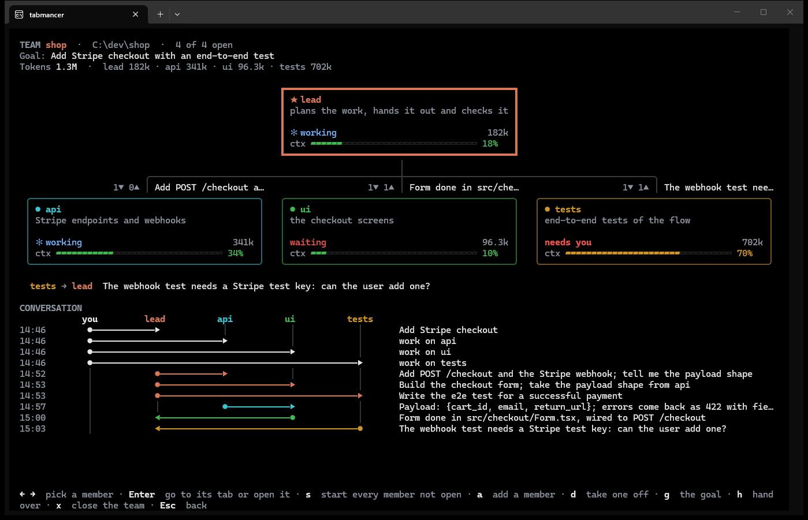
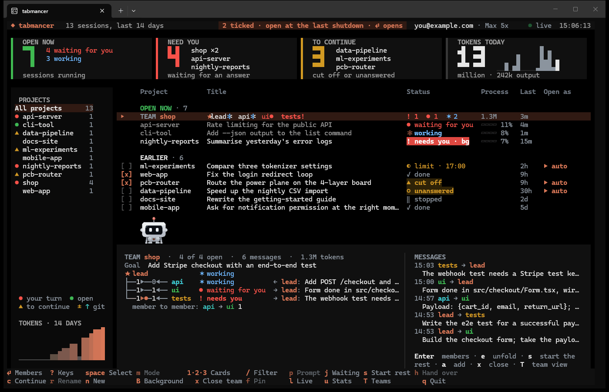

# Teams

[← tabmancer](../README.md)

A team is several sessions on one project, each with a focus of its own (the API, the
screens, the tests), and one of them the orchestrator that splits the goal into tasks and
hands them out. Press `T` and give the team a name, a project folder (it completes the
folders you have worked in), a goal and its members, one a line as `name: what they work
on`. The line-ups ready to use (feature team, bug hunt, write and review) are shown by
name, and `Ctrl+T` goes from one to the next. The lead's line is there too: leave it, or
change what it does. `@sonnet` (or any model Claude Code takes) at the end of a line runs
that member on that model, a lead on Opus and the tests on Sonnet, say. Under the form,
what will open is spelled out as you type (the tabs and their names), or what is still
missing. `Enter` and `Tab` go from box to box, and `Ctrl+S` starts the team. `Ctrl+L`
keeps the members in the box as a line-up of your own, under a name; it is then among the
line-ups `Ctrl+T` goes through, and `Ctrl+L` twice on it forgets it.

`Ctrl+B` in the same form runs the members in the background instead (`claude --bg`): no tab
each, only the lead's, where you talk to the team. The members start first, the lead's tab
opens once they are up, and `B` lists them. `x` twice on the team stops them (`claude stop`;
their sessions stay), and `s` starts them in the background again.

Or let the lead decide: with the line-up **lead decides**, only the lead starts. It reads
the goal, looks at the project and picks the members the work needs, up to the limit you
set (4 unless you change it), fewer when the work is small: their names, their areas and,
when it matters, their models. It adds them with one command,
`tabmancer team add <team> "name: area @model; name: area"`, the only command it may run
without asking you (`--allowedTools=...,Bash(tabmancer team add:*)`). Each member opens in
its own tab (or, with `Ctrl+B`, in the background) and introduces itself to the lead, and the
team view shows them join.

While any of its members is open, the team heads OPEN NOW in the dashboard's own list, as
one row: the team's name, then each member's name after a sign of what it is doing (red `●`
when it waits for you, `!` when it needs you, Claude's turning star while it works, a grey
`●` when it is idle, waiting for its lead, amber `◐` when it stopped at a usage limit, `▲`
when it was cut off), what the open ones are doing in all (`● 1  ✶ 2`, with the same signs),
and the tokens it has used. When the
names do not fit, the quietest are counted (`+2`, red if one of them waits for you too), so
whoever waits for you stays named. `j` goes to the next member waiting for you and shows its
team's members. With the team's row highlighted, the preview shows who talks to whom: each
member on its wire from the lead, with the count of messages sent along it both ways and the
latest one beside it, and a message flying along the wires as it is sent. From 150 columns
the newest messages are listed beside it.

`Enter` on the team's row opens the team view. `e` unfolds the team: its members hang under
its row as a tree, the lead first, each with the latest message to or from it. A
member's row is an ordinary session row (`Enter`, `h`, `p` and the rest work as on any
other), and its preview says how many messages it got and sent. On the team's row, `s`
starts every member that is not open, `a` adds members (each opens and introduces itself to
the lead) and `x` twice closes the members' tabs.

A team whose members are all closed, after a restart say, stays a team: its row sits among
the closed sessions where it last worked, with a box to tick the whole team. `s` on it
starts the team: each member resumed as itself, the lead last, so the others are up when it
starts handing out work. A member opened any other way (ticked and opened, `p`, `c`, a
workspace) also comes back with its name, its role and the setting that lets the team's
messages in; a plain `claude --resume` would leave all three out. Members added to a closed
team wait to start with it.

Every member is an ordinary Claude Code session in its own tab, so it can be closed,
resumed and handed over like any other. Each starts with:

- a name (`--name shop-api`), which is how the others address it;
- its model (`--model sonnet`), if the line-up gave it one;
- its role, added to the system prompt (`--append-system-prompt`): its focus, the other
  members and who the orchestrator is;
- a setting that lets messages from the other sessions in (`--settings`, a small file of
  tabmancer's own: your settings are not touched).

They talk with Claude Code's own messaging between sessions: a member calls `SendMessage`
with another member's name, and the message arrives there as a new turn, even if that
session was idle. tabmancer never carries a message; it reads them back from the
transcripts to draw the team view:

- the orchestrator's card on top and the members' cards below it on a tree of wires, each
  card with what the member is doing (working, waiting, needs you, needs your OK, idle), how
  many messages it has not read, how full its context is (a small meter), its model and the
  tokens it has used. The cards grow with the window, a row of them under each wire, and the
  picked member's focus is written under them;
- on the wire to each member, how many messages went down it and back up (`3▼ 2▲`);
- every new message flying along the wires from sender to receiver;
- the conversation as a sequence diagram: a lane for each member (yours on the left), and
  for each message an arrow from the sender's lane to the receiver's, with what it said
  beside it. A message still on its way is a dashed arrow, and a new day is named. The
  prompts tabmancer starts members with are drawn as tabmancer's, quieter than yours.

`Enter` on a team's row opens that team's view. `T` lists the teams anywhere, to open one
or start a new one (on a team's row or a member, with that team picked). `←` `→` pick
a member: its card, its lane and its arrows stay lit and the rest go quiet; past the last
member everyone is lit again. `Enter` goes to the member's tab (or opens it if it is
closed), `s` starts every member that is not open, and `a` adds members, who introduce
themselves to the orchestrator. `d` twice takes the picked member off the team (never the
lead); its sessions stay, as ordinary ones. `g` changes the team's goal; members started
from then on get it in their role. An open lead started with the old line-up or goal, so
either way a note for it goes to the clipboard and you to its tab, to paste it. `x` twice
closes the whole team: every open member's tab, Claude exiting as on `/exit`, so `s` starts
them again later. Under the goal, the tokens the team has used, and each member's.
