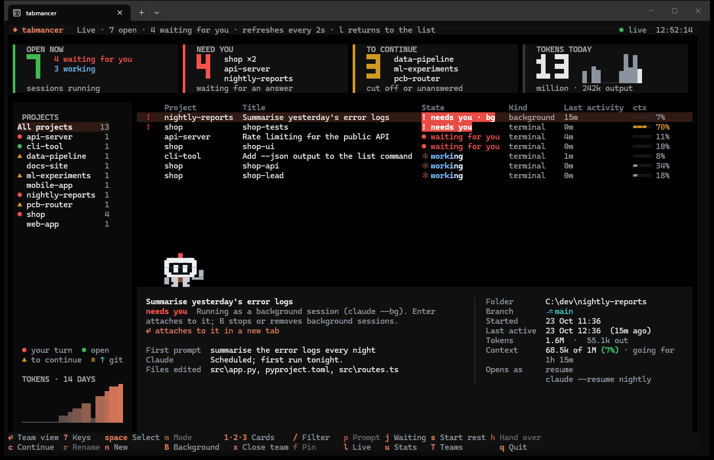

# Using tabmancer

[← tabmancer](../README.md)

## What the status means

| Status | Meaning |
|---|---|
| ● running | open in another terminal right now (cannot be ticked) |
| ◆ background | a background session (`claude --bg`); opening it attaches to it |
| ✓ done | Claude had finished its reply; the session was waiting for you |
| ‖ stopped | you pressed Esc while Claude was replying |
| ▲ cut off | closed while Claude was still working: a tool call or reply was in flight |
| ○ unanswered | your last message never got a reply |
| × error | the last reply was an API error |
| ◐ limit · 16:00 | stopped at a usage limit, which lifts at 16:00 (then: `limit lifted`) |
| × connection lost | the connection to the API dropped, so the reply never came |

A session stopped at a usage limit says when the limit lifts, whether it is still open or
not, and does not count as waiting for you. `c` asks what to do with all of them:

- **Continue them now.** For when you have signed in with another account (`/login`), or the
  limit has lifted.
- **Continue them when the limit lifts.** The dashboard has to be open at that time; the plan
  is kept if you restart it. `c` again can call it off.

Either way a closed session opens in a new tab, and an open one gets the prompt in its own
tab, as if you had typed it there: on Windows it goes into that tab's console, and no window
comes to the front. Only the process Claude Code lists for that session gets it, and its tab
is never closed. Where the prompt cannot be typed in (not on Windows, say), Bit says which
sessions to continue by hand. When the top bar's last reading shows room on your plan,
continuing now is offered first. Auto-continue tells Claude what stopped the session (a
shutdown, a usage limit or a dropped connection), unless you set a prompt of your own.

The list keeps the open sessions under **OPEN NOW** and the rest under **EARLIER**. For an
open session the **Process** column shows how full its context is. For a closed one it is
empty when the Claude process closed normally (exit, a closed window or an OS shutdown;
the preview says `clean`) and says `killed` when it died without cleaning up (a crash,
power loss, killed from Task Manager). **Open as** is shown only when a session would not
simply be resumed.

Each colour means one thing everywhere: red is your turn (a session waiting for you, and
the NEED YOU card), amber is work to continue (cut off, unanswered, and the TO CONTINUE
card), blue is at work, green is open, grey is done. A state that wants you (needs you, cut
off, unanswered, a limit lifted) is a badge on its own colour; the rest are plain words. The
highlighted row takes the theme's colour. Under the projects, a legend says what their marks
mean. Beside each card's number is what it counts: the open sessions by what they are doing,
the projects waiting for you or with work to continue, and today's tokens hour by hour. In a
window under 40 rows each card is two lines instead, its number and then what it counts, so
the list keeps its room. The top bar shows what the list is narrowed to and how many sessions
are ticked as pills that a narrow window never cuts off.

## Keys

The footer shows most keys, on two rows when one is too narrow for them (three in a very
narrow window), so none is cut off. It follows the highlighted row: on a team's row `s` reads
"Start rest" and `x` "Close team", with sessions ticked `Enter` reads "Open 2", and a key that
does nothing on the row is dimmed there (never hidden). The keys keep to the groups `?` shows
them in. `?` lists every key with what it does, and runs the one you pick with `Enter`. Under
the highlighted session the preview says what `Enter` will do with it, as it stands.

| Key | Action |
|---|---|
| `?` | every key, explained; `Enter` runs the one picked |
| `Space`, click `[ ]` | tick / untick a session; on a closed team's row, all its members |
| `Enter` | open the ticked sessions (or the highlighted one if none are ticked); on a team's row, its members, then the team view; on a closed team's row, start the team |
| `j` | go to the next open session waiting for you (again for the one after) |
| `m` | cycle how it opens: resume → auto-continue → fork → new |
| `a` | tick / untick everything visible; on a team's row, add members |
| `/` | find by project, title, or anything said in a session (`Esc` clears) |
| `1` `2` `3`, click a card | only what OPEN NOW, NEED YOU or TO CONTINUE counts; again (or `Esc`) shows all. A click on TOKENS TODAY opens the stats |
| `w` | save the ticked sessions' folders as a workspace |
| `o` | open a workspace (`d` deletes one) |
| `s` | AI summary of the highlighted session; on a team's row, start every member not open |
| `l` | switch to the live view and back |
| `e`, click | open the row to see how the session ended (again to close); on a team's row, its members under it (again to fold) |
| `p` | write a prompt to the highlighted session |
| `n` | start fresh sessions in several projects at once |
| `T` | teams: several sessions on one project with an orchestrator, talking to each other; on a team's row or a member, that team's view |
| `h` | hand a session over to a fresh one; an open one is closed |
| `c` | the sessions stopped at a usage limit: continue them now (signed in with another account) or when the limit lifts (in the footer only while one is) |
| `r` | rename the highlighted session (see below) |
| `x` | hide the ticked sessions, or the highlighted one (in the sidebar: the whole project); nothing is deleted. On an open team's row, twice: close its members' tabs |
| `X` | show the hidden ones too (`x` on one brings it back) |
| `f` | pin the ticked sessions, or the highlighted one, above the rest; again unpins |
| `u` | stats: tokens, when you work, tools and files, plan limits, a written report |
| `B` | background sessions: attach, stop, remove, clean up |
| `,` | which CLIs to list: Claude Code, Codex, Antigravity |
| `t` | next colour theme (remembered) |
| `b` | Bit on or off (remembered) |
| `Tab` | move between the project sidebar and the session list |
| `q`, `Esc` | quit (`Esc` first clears the filter, then a card's) |

**resume** runs `claude --resume <id>`. **auto-continue** resumes and immediately tells
Claude to carry on with the interrupted work, so you do not have to type "continue" in
every tab. It is the default for sessions that were cut off, left unanswered or ended
on an error. **fork** runs `claude --resume <id> --fork-session`, a new session that
starts from a copy of the history. **new** runs a fresh `claude` in that session's folder.
A session that is open right now, in another tab or in the background, is never resumed a
second time: just before it opens anything, tabmancer asks again which sessions are open,
since the list can be a moment behind. And if one it opened has not come up after a while
(Claude Code would not resume it, its folder gone say), the dashboard names it; its tab says why.
To move a session's work to a fresh one, press `h` (see
[Crowded sessions and handing over](handover.md#crowded-sessions-and-handing-over)).

To change what auto-continue says: `tabmancer continue-prompt "Pick up where you left off"`.

`r` renames a Claude Code session the way `/rename` does inside it, so the new name shows
in Claude Code's own `/resume` list too. A closed session runs `/rename` once without a tab
(`claude -p --resume`), which asks no model. An open one has to do it itself, or its next
turn would write the old name back: `/rename` goes to your clipboard and its tab comes to
the front, to paste. Team members keep their names, since the team finds them by it.

## Write to a session

Press `p` on a session and type what Claude should do next.

- **Enter** opens the session in a new tab with your prompt already sent
  (`claude --resume <id> "<prompt>"`).
- **Ctrl+B** runs it in the background instead (`claude --bg --resume <id> "<prompt>"`). The
  dashboard shows it working and tells you when it needs you. `Enter` on it attaches.
  `B` stops or removes it when you are done (see [Background sessions](#background-sessions)).

The dashboard stays open either way, so you can write to several sessions in a row.

A session that is already open in another tab cannot be written to from outside, so for
those `p` (or `Enter`) takes you there instead. It selects that session's tab and brings
its window to the front, ready for you to type: in Windows Terminal, in tmux (the pane
whose title is the session's), and on macOS in iTerm2 and Terminal. The tab is found by
its title, which Claude Code sets to the session's name.

Click a session, or press `e`, to open its row and see what it came to: Claude's answer
for a finished session, the question left hanging for a cut-off one, or the AI summary
once one exists. Click it again to close it. Clicking its `[ ]` box ticks it instead.
Opened rows stay open while the list updates.

## Live view



`tabmancer live`, or `l` in the picker, lists only the sessions that are open right now.
It refreshes every few seconds and sorts them by what needs you first:

- **needs you**: a background session reports that it is blocked
- **waiting for you**: Claude finished and the session is idle
- **working**: Claude is busy. If it has written nothing for five minutes, the row adds
  "quiet", which usually means a long command or an unanswered permission prompt.

The dashboard stays live in both views. Every two seconds it reads Claude Code's
live-session files, which costs next to nothing. Every 16 seconds it also asks
`claude agents --json`, which covers background sessions and notices sessions that
have closed. When a session goes from working to waiting, a note pops up. In the live
view the terminal bell rings as well.

## Background sessions

A background session (`claude --bg`) keeps its process running after Claude has
finished, waiting for a next message, and Claude Code keeps its entry after the process
ends. Both pile up. Press `B` to see every background session Claude Code knows:

- **Enter** attaches to it in a new tab (`claude attach <id>`).
- **x** stops it (`claude stop <id>`). Its conversation is kept, and attaching starts it
  again. A session that is working or waiting for an answer asks you to press `x` twice.
- **d** removes it (`claude rm <id>`), after a second press. That deletes the entry and
  its worktree. The transcript stays, so the session is still in the list and can be
  resumed. If the worktree has unpushed commits, Claude Code does not discard them; it reports them instead.
- **c** cleans up: it removes every background session that is idle or has stopped,
  after a second press. Sessions that are working or waiting for you are left alone.

Bit mentions it when background sessions sit idle.

## Fresh sessions

A long conversation carries its whole history into every turn, so starting clean is
often the better move. Press `n`:

- The projects you worked in lately are listed, newest first, with the folders of your
  workspaces. Type to filter them, or type any folder path to add it.
- `Space` ticks a project. Write a first message if you want one: every new session
  gets it, so they all start working right away.
- `Enter` opens a fresh session in each ticked folder, each in its own tab.
- With more than one CLI on, `Ctrl+O` picks which one to start.

These start clean. To carry a session's work on in a fresh one, hand it over with `h`
instead (see [Crowded sessions and handing over](handover.md#crowded-sessions-and-handing-over)).

From a shell or a script:

```sh
tabmancer new web-app api-server --prompt "Run the tests and fix what fails"
tabmancer new C:\dev\new-idea --cli codex
```

A name is matched against the projects you worked in lately; a path works anywhere.

## Workspaces

A workspace remembers folders, not sessions. Session ids go stale as soon as you
`/clear` or start a new session. Opening a workspace therefore continues the most
recent session in each folder, the way `claude --continue` would. A folder saved
twice continues its two most recent sessions. Sessions that are already open count,
so nothing opens twice. Rows set to **new** in the picker are saved as "start a fresh
session here".

```sh
tabmancer open "PCB work"                    # open it without the picker
tabmancer workspaces                         # list them (--delete NAME to remove one)
tabmancer shortcut --workspace "PCB work"    # Windows: a desktop shortcut for it
```

## Hide and pin

Old work and test sessions need not crowd the list, and nothing has to be deleted for that.
`x` hides the ticked sessions, or the highlighted one; with a project picked in the sidebar,
it hides the whole project. Hidden ones drop out of the list, the counters and the sidebar,
and are not ticked for reopening; their transcripts stay where they are. The status line
says how many are hidden, `X` lists them too (marked `hidden`), and `x` on one brings it
back. An open session always shows. `f` pins sessions: they stand under **★ PINNED**,
above the rest. Both are kept in `marks.json` in tabmancer's own folder.
